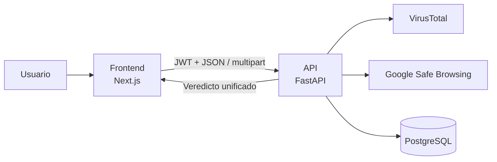

<div align="center">

# 🎣 PhishCatch · Frontend

**Plataforma web de inteligencia de amenazas para prevenir el phishing.**
Pega un enlace sospechoso o sube un correo y obtén un veredicto claro en segundos: **Seguro**, **Sospechoso** o **Malicioso**.


[**Ver demo en vivo**](https://phish-cat-front.vercel.app) · [API (Swagger)](https://phishcatchback-production.up.railway.app/docs)

</div>

---

## Tabla de contenido

- [¿Qué es PhishCatch?](#qué-es-phishcatch)
- [¿Qué hace?](#qué-hace)
- [Cómo funciona](#cómo-funciona)
- [Vistas](#vistas)
- [Tecnologías](#tecnologías)
- [Requisitos](#requisitos)
- [Instalación y ejecución local](#instalación-y-ejecución-local)
- [Variables de entorno](#variables-de-entorno)
- [Modo demo (sin backend)](#modo-demo-sin-backend)
- [Scripts disponibles](#scripts-disponibles)
- [Estructura del proyecto](#estructura-del-proyecto)
- [Contrato con la API](#contrato-con-la-api)
- [Niveles de riesgo](#niveles-de-riesgo)
- [Despliegue en Vercel](#despliegue-en-vercel)
- [Seguridad](#seguridad)
- [Solución de problemas](#solución-de-problemas)
- [Limitaciones conocidas](#limitaciones-conocidas)
- [Licencias de terceros](#licencias-de-terceros)
- [Aviso legal](#aviso-legal)
- [Licencia](#licencia)

---

## ¿Qué es PhishCatch?

El phishing sigue siendo una de las formas más comunes de robo de credenciales y fraude. **PhishCatch** ayuda a cualquier persona, sin conocimientos técnicos, a saber si un enlace o un correo electrónico es peligroso **antes** de abrirlo.

Este repositorio contiene el **cliente web (frontend)**. Se comunica con una API en Python (FastAPI) que consulta varias fuentes de inteligencia de amenazas y devuelve un dictamen unificado. El frontend se encarga de mostrarlo de forma visual, clara y comprensible.

## ¿Qué hace?

- 🔐 **Autenticación**: registro e inicio de sesión con JWT; las páginas privadas están protegidas y la sesión expirada redirige a `/login`.
- 🔗 **Análisis de URLs**: consulta **VirusTotal** (≈90 motores de seguridad) y **Google Safe Browsing** en paralelo, y muestra el resultado de cada fuente por separado.
- 📧 **Análisis de correos**, de dos formas:
  - subiendo un archivo `.eml` (arrastrar y soltar), o
  - pegando el **texto original** del correo (“Mostrar original” en Gmail / “Ver origen del mensaje” en Outlook).
- 🛡️ **Anti-spoofing**: verifica **SPF, DKIM y DMARC**, compara el remitente visible con la ruta de retorno (`Return-Path`) y alerta de una posible suplantación de identidad.
- 🧾 **Enlaces del correo**: extrae los enlaces del cuerpo y entrega un veredicto individual por cada uno.
- 🕘 **Historial**: lista de análisis anteriores con fecha, objetivo, tipo y veredicto.
- 🌙 **Interfaz oscura** (estilo Vercel / GitHub) pensada para usuarios no técnicos: semáforo de riesgo con íconos, mensajes en español y estados de carga y error.

## Cómo funciona



1. El usuario inicia sesión; el token JWT se guarda en el navegador y un interceptor de Axios lo añade a cada petición privada.
2. Al analizar una URL o un correo, el frontend llama a la API, que consulta las fuentes externas y guarda el resultado en el historial.
3. El frontend interpreta la respuesta y pinta el veredicto, las tarjetas por motor y los detalles.

## Vistas

| Ruta | Descripción |
|---|---|
| `/login` · `/register` | Formularios con validación (React Hook Form + Zod), spinner de carga y alertas de error. |
| `/dashboard` | Pestañas **Analizar URL** y **Analizar correo** (archivo `.eml` o texto pegado). Al terminar muestra la pantalla de resultados. |
| `/history` | Tabla con los análisis anteriores y estado vacío para usuarios nuevos. |

**Resultado de URL:** banner de veredicto, una tarjeta por fuente (VirusTotal y Google Safe Browsing), barra segmentada de motores con contadores (maliciosos, sospechosos, inofensivos, sin detectar) y botón para copiar la URL.

**Resultado de correo:** banner de riesgo global, insignias SPF/DKIM/DMARC, alerta de suplantación, metadatos (De, Para, Asunto, Fecha, Ruta de retorno) y tabla de enlaces con su veredicto.

## Tecnologías

| Área | Herramienta |
|---|---|
| Framework | [Next.js 14](https://nextjs.org/) (App Router) + React 18 + TypeScript |
| Estilos | [Tailwind CSS 3](https://tailwindcss.com/) |
| Peticiones HTTP | [Axios](https://axios-http.com/) (interceptores para JWT y error 401) |
| Estado / sesión | [Zustand](https://zustand-demo.pmnd.rs/) con persistencia en `localStorage` |
| Formularios | [React Hook Form](https://react-hook-form.com/) + [Zod](https://zod.dev/) |
| Subida de archivos | [react-dropzone](https://react-dropzone.js.org/) |
| Íconos | [Lucide](https://lucide.dev/) |
| Tipografías | IBM Plex Sans y JetBrains Mono, empaquetadas con [Fontsource](https://fontsource.org/) |
| Despliegue | [Vercel](https://vercel.com/) |

## Requisitos

- [Node.js](https://nodejs.org/) **18.17 o superior** (recomendado: 20 LTS)
- npm (incluido con Node.js)
- Opcional: el backend de PhishCatch en ejecución, o usar el [modo demo](#modo-demo-sin-backend)

## Instalación y ejecución local

```bash
# 1. Clonar el repositorio
git clone https://github.com/<TU_USUARIO>/phish-cat-front.git
cd phish-cat-front

# 2. Instalar dependencias
npm install

# 3. Crear el archivo de entorno
cp .env.local.example .env.local        # macOS / Linux
# Copy-Item .env.local.example .env.local   # Windows (PowerShell)

# 4. Iniciar el servidor de desarrollo
npm run dev
```

Abre <http://localhost:3000>. Te llevará a `/login`.

Para compilar y ejecutar la versión de producción:

```bash
npm run build
npm run start
```

## Variables de entorno

Se definen en `.env.local` (nunca se sube al repositorio).

| Variable | Descripción | Valor por defecto |
|---|---|---|
| `NEXT_PUBLIC_API_URL` | URL base de la API, **incluyendo** `/api/v1` y `https://` | `https://phishcatchback-production.up.railway.app/api/v1` |
| `NEXT_PUBLIC_USE_MOCK` | `true` activa el [modo demo](#modo-demo-sin-backend); `false` usa la API real | `false` |

> Las variables `NEXT_PUBLIC_*` se incrustan en el build. Si las cambias, reinicia `npm run dev` o vuelve a desplegar.

Para trabajar contra un backend local:

```env
NEXT_PUBLIC_API_URL=http://localhost:8000/api/v1
NEXT_PUBLIC_USE_MOCK=false
```

## Modo demo (sin backend)

Con `NEXT_PUBLIC_USE_MOCK=true` la app simula la API en el navegador, útil para trabajar en el diseño o hacer demostraciones sin conexión.

- Usuario de prueba: `demo@phishcatch.com` · contraseña `demo1234`
- También puedes registrar cuentas nuevas (se guardan solo en tu navegador).
- Resultado de URLs según lo que pegues: una URL con `paypal`, `login` o `phish` sale **maliciosa**; una sin `https` o acortada (`bit.ly`) sale **sospechosa**; el resto sale **segura**.
- Resultado de correos según el nombre del archivo: `malicioso.eml`, `sospechoso.eml`, `seguro.eml`.

## Scripts disponibles

| Comando | Descripción |
|---|---|
| `npm run dev` | Servidor de desarrollo con recarga en caliente |
| `npm run build` | Compila para producción y revisa los tipos |
| `npm run start` | Ejecuta la versión compilada |

## Estructura del proyecto

```text
src/
├─ app/
│  ├─ layout.tsx            # Layout raíz y fuentes
│  ├─ page.tsx              # Redirige a /dashboard
│  ├─ login/ · register/    # Autenticación
│  ├─ dashboard/            # Análisis de URLs y correos
│  ├─ history/              # Historial de análisis
│  └─ icon.png · apple-icon.png · favicon.ico
├─ components/
│  ├─ AuthForm.tsx          # Formulario de login / registro
│  ├─ AuthGuard.tsx         # Protege las páginas privadas
│  ├─ Navbar.tsx · Logo.tsx
│  ├─ ScanPanel.tsx         # Pestañas, dropzone, texto pegado y resultados
│  ├─ RiskBanner.tsx        # Banner y etiquetas de veredicto
│  ├─ EngineSourceCard.tsx  # Tarjeta por motor (VirusTotal / Google)
│  ├─ UrlScanResultCard.tsx
│  ├─ EmailScanResultCard.tsx
│  └─ ResultSkeleton.tsx
├─ lib/
│  ├─ api.ts                # Cliente Axios, servicios y modo demo
│  ├─ scan.ts               # Normaliza la respuesta de la API
│  ├─ risk.ts               # Estilos de riesgo y formato de fechas
│  └─ types.ts              # Tipos de TypeScript
└─ store/
   └─ auth.ts               # Sesión (Zustand)
```

## Contrato con la API

Base: `NEXT_PUBLIC_API_URL`. Los endpoints privados requieren `Authorization: Bearer <token>`.

| Método | Ruta | Descripción |
|---|---|---|
| `POST` | `/auth/register` | Crea una cuenta (JSON `email`, `password`) |
| `POST` | `/auth/login` | Inicia sesión (`application/x-www-form-urlencoded` con `username` y `password`) |
| `POST` | `/scan/url` | Analiza una URL (JSON `url`) |
| `POST` | `/scan/email` | Analiza un archivo `.eml` (`multipart/form-data`, campo `file`) |
| `POST` | `/scan/email/text` | Analiza el texto original de un correo (JSON `raw_email`) |
| `GET` | `/history/` | Lista los análisis del usuario |

Detalles que el frontend ya maneja:

- `details` es un objeto multimotor: `details.virustotal` (estadísticas por motor) y `details.google` (Google Safe Browsing). Un `matches: []` de Google significa **sin amenazas**, nunca un error.
- Para correos, la autenticación llega en `details.security_headers` y los enlaces en `details.urls_details`.
- El backend usa `scan_type: "file"` para correos; el frontend lo convierte a `email`.
- Un `risk_level` desconocido (`error`, `unknown`, `pending`) se muestra como **Sin veredicto**.
- El historial se pide con barra final (`/history/`) para evitar una redirección 307 detrás del proxy.

## Niveles de riesgo

| Veredicto | Significado | Color |
|---|---|---|
| **Seguro** | No se encontraron amenazas en las fuentes consultadas | 🟢 Verde |
| **Sospechoso** | Señales dudosas; conviene tener precaución | 🟡 Ámbar |
| **Malicioso** | Amenaza detectada; no abrir ni ingresar datos | 🔴 Rojo |
| **Sin veredicto** | Las fuentes no respondieron (error o límite de consultas) | ⚪ Gris |

El veredicto lo calcula el backend combinando las fuentes. Que el resultado sea “Seguro” significa que **no hay coincidencias en las listas consultadas**, no una garantía absoluta de que el sitio sea confiable.

## Despliegue en Vercel

1. Sube el proyecto a GitHub.
2. En [vercel.com](https://vercel.com) elige **Add New → Project** e importa el repositorio. Vercel detecta Next.js automáticamente.
3. En **Environment Variables** agrega `NEXT_PUBLIC_API_URL` y `NEXT_PUBLIC_USE_MOCK=false`.
4. Pulsa **Deploy**.
5. **Habilita CORS en el backend:** agrega tu dominio de producción a `BACKEND_CORS_ORIGINS`, con formato de lista JSON, comillas dobles y sin barra final:

   ```json
   ["http://localhost:3000","https://tu-proyecto.vercel.app"]
   ```

Cada `git push` a la rama principal despliega automáticamente. Las URLs de vista previa de Vercel (por rama o commit) no estarán permitidas por CORS salvo que se agreguen.

## Seguridad

- Este repositorio **no contiene claves ni secretos**: las claves de VirusTotal y Google viven únicamente en el backend.
- `.env.local` está en `.gitignore`. No subas archivos `.env`.
- El token JWT se guarda en `localStorage`. Es sencillo y adecuado para este proyecto, pero es accesible desde JavaScript; en un entorno de producción exigente conviene evaluar cookies `HttpOnly`.
- Las contraseñas deben tener entre 8 y 72 caracteres (límite de bcrypt en el backend).
- Si crees haber expuesto una clave, **regénerala** en el panel del proveedor.

## Solución de problemas

| Síntoma | Causa probable | Solución |
|---|---|---|
| “No se pudo conectar con el servidor” | CORS no habilitado o URL de API incorrecta | Revisa `BACKEND_CORS_ORIGINS` en el backend y `NEXT_PUBLIC_API_URL` (con `https://`) |
| Las peticiones van a `localhost` | Variables sin actualizar | Corrige `.env.local` y reinicia; en Vercel, haz **Redeploy** |
| Pantalla de carga infinita | Versión antigua del store de sesión | Usa la última versión del código |
| Falla el build en Vercel por `next/font` | Descarga intermitente de Google Fonts | Ya resuelto: las fuentes van empaquetadas con Fontsource |
| Análisis lento | VirusTotal se consulta con sondeo | Normal: puede tardar hasta unos 20 s por URL; el límite del cliente es 120 s |
| Resultado “Sin veredicto” | Límite de consultas de la API gratuita de VirusTotal | Espera un minuto e inténtalo de nuevo |

## Limitaciones conocidas

- El historial no guarda el detalle completo, por lo que no se puede reabrir un análisis anterior.
- Se analizan como máximo 5 enlaces por correo.
- Google Safe Browsing no lista todas las amenazas (por ejemplo, URLs de malware alojadas en direcciones IP); por eso una fuente puede marcar algo que la otra no.
- Las APIs gratuitas de VirusTotal y Google Safe Browsing tienen límites de uso y están pensadas para uso no comercial.

## Licencias de terceros

Este proyecto usa software de código abierto, cada uno bajo su propia licencia:

- Next.js, React, Tailwind CSS, Axios, Zustand, React Hook Form, Zod, react-dropzone: **MIT**
- Lucide (íconos): **ISC**
- IBM Plex Sans y JetBrains Mono (vía Fontsource): **SIL Open Font License 1.1**

## Aviso legal

PhishCatch es un proyecto **académico y educativo**. Los resultados son **orientativos** y dependen de servicios de terceros; no sustituyen el criterio del usuario ni una evaluación de seguridad profesional. Se ofrece “tal cual”, sin garantías. Usa las APIs de terceros respetando sus términos de servicio.

## Licencia

Distribuido bajo la licencia **MIT**. Consulta el archivo [LICENSE](./LICENSE) para más información.
